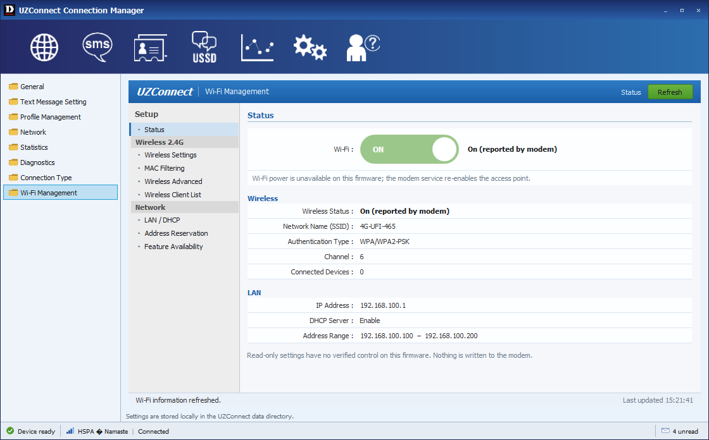
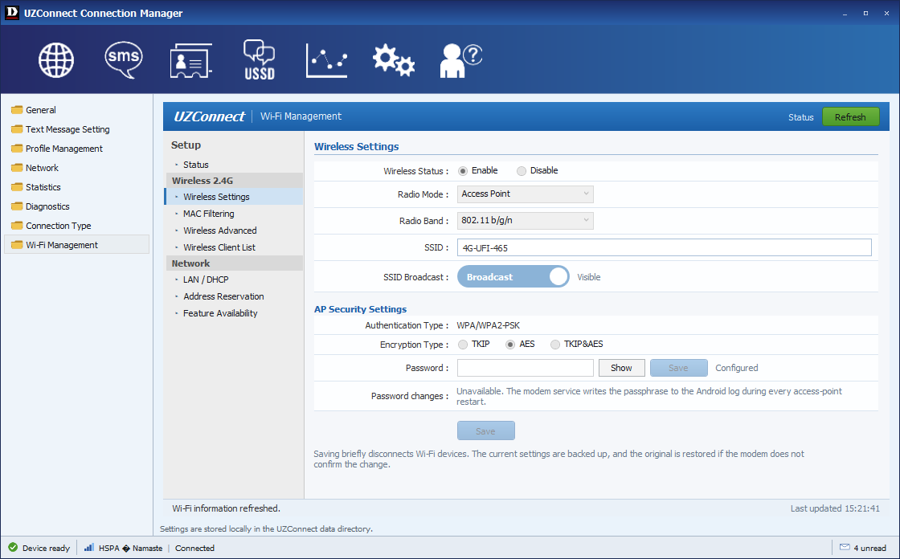
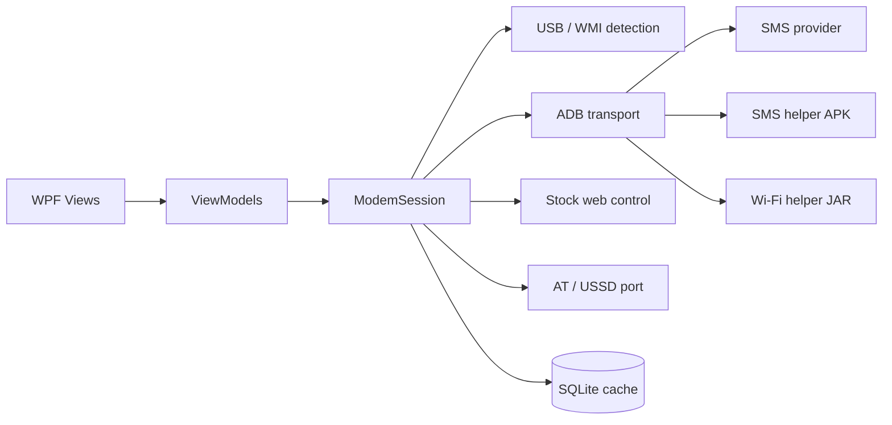

<p align="center">
  
</p>

<h1 align="center">UZConnect</h1>

<p align="center">
  <b>A classic Windows connection manager for the UZ801 4G USB modem</b><br />
  Connection · SMS · Contacts · USSD · Statistics · Settings · Wi-Fi
</p>

<p align="center">
  <a href="https://github.com/shamirbaral5180/UZConnect_App/releases/latest">
    
  </a>
  
  
  
  
  
</p>

<p align="center">
  <a href="#-download"><b>Download</b></a> ·
  <a href="#-screenshots"><b>Screenshots</b></a> ·
  <a href="#-features"><b>Features</b></a> ·
  <a href="#-wifi-management"><b>Wi‑Fi</b></a> ·
  <a href="#-build-from-source"><b>Build</b></a> ·
  <a href="docs/WIFI-MANAGEMENT.md"><b>Docs</b></a>
</p>

---

## Why UZConnect?

The **FY_UZ801_V3.2** is a small Qualcomm MSM8916 LTE dongle that ships with a stripped
Android build and a basic web page. UZConnect gives it the desktop manager it should have
had: a classic D‑Link‑style window with real SMS, USSD, APN and Wi‑Fi tools — no browser,
no firmware flashing, no vendor cloud.

> **Design rule:** the app never claims a change it has not read back from the modem.
> Wi‑Fi settings are backed up, applied, verified in both the active and saved configuration,
> and rolled back automatically if verification fails.

---

## 📸 Screenshots

<p align="center">
  
</p>

<p align="center">
  
</p>

---

## ⬇ Download

**[Download the latest release »](https://github.com/shamirbaral5180/UZConnect_App/releases/latest)**

| | |
|---|---|
| **Single-file (recommended)** | `UZConnect-0.1.0-win-x64.exe` — download and run, nothing to unzip |
| Portable build | `UZConnect-0.1.0-win-x64.zip` (~62 MB) |
| Requirements | Windows 10/11 x64 · UZ801 modem over USB · ADB authorized |
| Runtime | None — .NET 10 is bundled |

1. Download the `.exe` and run it (or unzip the portable build).
2. Plug in the modem and wait for **Device ready**.
3. If ADB is not detected, open **Settings → General** and point UZConnect at `adb.exe`.
4. SMS sending needs the bundled helper; install it once from **Settings → General**.

---

## ✨ Features

| Area | What you get |
|---|---|
| **Connection** | Live operator, network type, signal, data session, IP, duration, speed graph, connect/disconnect |
| **APN** | Profile list, create/edit, NTC and Ncell defaults, manual connect |
| **SMS** | Inbox/Sent/Drafts/Recycle, selection and select‑all, confirmed multi‑delete, classic Edit dialog, compose/reply/forward/export, delivery reports |
| **USSD** | Saved command list, balance and menu replies, temporary 3G switching for USSD and automatic restore |
| **Contacts** | Read‑only SIM phonebook (by design) |
| **Statistics** | Live upload/download rates, totals, session time |
| **Wi‑Fi** | Router‑style page: status, network name, device limit, security/channel/broadcast, connected clients, DHCP ranges |
| **Diagnostics** | Redacted report export; no passwords, SMS bodies or full IMEIs |

### Status at a glance

| Capability | State |
|---|---|
| USB detection, ADB, device/SIM/network info | ✅ Verified |
| Mobile data, APN profiles (NTC / Ncell) | ✅ Verified |
| SMS read, send, delete, recycle | ✅ Verified |
| USSD balance and interactive menus | ✅ Verified |
| Wi‑Fi status, client list, DHCP ranges | ✅ Verified |
| Wi‑Fi name and maximum devices | ✅ Verified with backup, verification and rollback |
| Wi‑Fi ON/OFF, password, hidden SSID | ⛔ Disabled — blocked by stock firmware |
| Channel, security mode, DHCP/DNS editing | 👁 Read‑only |

---

## 📶 Wi‑Fi Management

The Wi‑Fi section is a self‑contained router‑style page: blue header, grouped navigation,
underlined section titles and light tables. It shows the real access‑point state, the network
name, connected devices with IP and MAC, and the active DHCP ranges.

**Saving the network name or device limit** runs a transaction:

1. Read and verify the current state.
2. Back up `mificonfig.json`, `hostapd.conf` and `softap.conf` with hashes.
3. Apply and restart the access point.
4. Require three agreeing observations across a watchdog interval — active config, saved
   config, vendor status, `hostapd` and `rndis0`.
5. On failure, restore the backup and verify it again.

**Wi‑Fi ON/OFF, password changes and hidden SSID are intentionally disabled.** On stock
V2.3.11 the vendor service re‑asserts its own in‑memory settings on every bind, and the
networking service writes the WPA passphrase to the Android log during every access‑point
start. No safe, durable control exists without modifying system components, so UZConnect
shows the controls disabled with the reason instead of faking success.

> Full evidence and the required system changes: **[docs/WIFI-MANAGEMENT.md](docs/WIFI-MANAGEMENT.md)**

---

## 🧱 Architecture



- `UZConnect.Core` — contracts, models, SMS segment logic, parsers
- `UZConnect.Windows` — USB discovery, ADB, stock control channel, serial USSD, SQLite, session
- `UZConnect.App` — WPF MVVM interface in the classic Connection Manager style
- `tools/agent` — minimal Android SMS helper
- `tools/wifi` — root Wi‑Fi state helper and hardware qualification harness
- `tests` — 30 unit tests

The UI never touches hardware directly; every transport sits behind `ModemSession`.

---

## 🔒 Safety and privacy

- **No firmware flashing, partition writes, bootloader changes or rooting.**
- SMS deletion is confirmed first and copied to a local Recycle bin.
- Wi‑Fi passwords are never displayed, logged or exported.
- SMS bodies, phone numbers and full IMEIs are never written to logs.
- IMEI is masked by default.
- The bundled Android helper is a normal app installed over ADB; it is not part of the firmware.

---

## 🛠 Build from source

**Prerequisites:** .NET 10 SDK, Windows 10/11, Android platform‑tools for `adb.exe`.

```powershell
git clone https://github.com/shamirbaral5180/UZConnect_App.git
cd UZConnect_App
dotnet build UZConnect.slnx -c Release
dotnet test tests\UZConnect.Tests\UZConnect.Tests.csproj -c Release
```

Build the Wi‑Fi helper (optional, the jar is committed):

```powershell
powershell -File tools/wifi/build.ps1
```

Publish a self‑contained build:

```powershell
dotnet publish src\UZConnect.App\UZConnect.App.csproj -c Release -r win-x64 --self-contained true -o artifacts\UZConnect-win-x64
```

---

## 📚 Documentation

| Document | Contents |
|---|---|
| [Hardware report](docs/HARDWARE-REPORT.md) | USB identity, ADB, SMS, USSD and stock control‑channel evidence |
| [Wi‑Fi management](docs/WIFI-MANAGEMENT.md) | Verified mechanisms, qualification results, blockers and required changes |
| [UI reference](docs/UI-REFERENCE.md) | Layout and asset notes from the D‑Link Connection Manager |
| [Release notes](docs/RELEASE-NOTES-0.1.0.md) | What ships in 0.1.0 and what is deliberately disabled |

---

## ⚠️ Disclaimer

UZConnect is an independent project, not affiliated with the modem vendor or D‑Link.
It targets **stock firmware V2.3.11** and is tested on one **FY_UZ801_V3.2** unit.
Use at your own risk; keep a working ADB connection before changing network settings.

<p align="center">
  <sub>Built with C# · .NET 10 · WPF · MVVM</sub>
</p>
